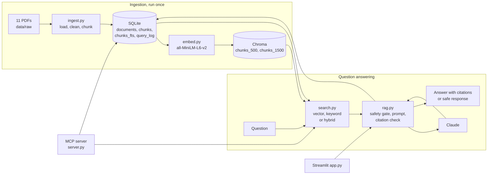

# WiSec Assistant

An AI-powered knowledge assistant that answers questions about wireless security from 11 official NIST and NSA publications (Wi-Fi, Bluetooth, LTE and 5G). It retrieves relevant passages with vector search, generates an answer with a language model, cites the passages it used, and gives a safe response when the documents do not contain the answer. The search is also exposed through an MCP server.

Advanced Database Systems, Final Project (Option 2: AI-Powered Knowledge Assistant).

Team: Satyamani Abhiram Kasireddi, Saloni Rajendra Naikwadi, Sarra Ali Ahmed Rashd

## Quick start

Requires Python 3.10 to 3.13.

```bash
python -m venv .venv && source .venv/bin/activate
pip install -r requirements.txt
```

The repository already contains the source PDFs and the SQLite database (`db/metadata.db`, with chunks and keyword index). Only the vector index has to be built, because `db/chroma/` is not committed (about 4 minutes; the embedding model is downloaded on first use):

```bash
python src/embed.py
```

Then ask a question, in the browser or from the command line:

```bash
streamlit run app.py
```

```bash
python src/rag.py "What does SUCI stand for and what problem does it solve?"
```

### Language model

Answer generation needs a language model. Search, the MCP server and the retrieval evaluation work without one.

| Backend | When it is used | Setup |
| --- | --- | --- |
| Anthropic API | `ANTHROPIC_API_KEY` is set | `export ANTHROPIC_API_KEY=...` |
| `claude` command line tool | No API key, and Claude Code is installed | None |

Set `WISEC_LLM=anthropic` or `WISEC_LLM=claude-cli` to force one. `WISEC_MODEL` changes the model (default `claude-opus-5-5`).

## How it works



1. **Ingestion.** `ingest.py` extracts text from each PDF, removes headers, footers and page numbers, and splits the text into overlapping chunks at two sizes (500 and 1,500 characters). Chunks are stored in SQLite with their document and page range.
2. **Embedding.** `embed.py` embeds every chunk with all-MiniLM-L6-v2 (384 dimensions, runs locally) and stores the vectors in Chroma, one collection per chunk size. The Chroma ID of a vector is the `chunk_id` in SQLite.
3. **Search.** `search.py` offers vector search (cosine similarity in Chroma), keyword search (SQLite FTS5 with BM25 ranking) and hybrid search, which merges the two rankings with reciprocal rank fusion. All three return chunks joined with their document metadata.
4. **Answering.** `rag.py` retrieves the top k passages, refuses early if the best one is not similar enough, asks the model to answer only from the numbered passages, then checks that the answer cites real passages. Each question is logged in `query_log`.

## Repository layout

| Path | Purpose |
| --- | --- |
| `data/raw/` | The 11 source PDFs |
| `db/schema.sql` | Relational schema: `documents`, `chunks`, `query_log`, FTS5 index and triggers |
| `db/metadata.db` | SQLite database (committed) |
| `db/chroma/` | Chroma vector store (built by `embed.py`, not committed) |
| `src/config.py` | Paths and default settings |
| `src/init_db.py` | Create the database and register the documents |
| `src/ingest.py` | Load, clean and chunk the PDFs |
| `src/embed.py` | Generate embeddings and store them in Chroma |
| `src/build_fts.py` | Build the keyword index |
| `src/search.py` | Vector, keyword and hybrid search (also a command line tool) |
| `src/rag.py` | Answer generation with citations and safe responses |
| `src/server.py` | MCP server with four tools |
| `app.py` | Streamlit question-answering interface |
| `tests/test_mcp.py` | Sample requests for every MCP tool |
| `eval/` | Test questions, evaluation script and results |
| `docs/` | Technical report, MCP tool reference, evaluation, progress logs |

## Rebuilding from scratch

```bash
python src/init_db.py
```

```bash
python src/ingest.py
```

```bash
python src/build_fts.py
```

```bash
python src/embed.py
```

`ingest.py` rebuilds every chunk, so run `embed.py` after it to keep the vector index in sync.

## Search from the command line

```bash
python src/search.py "Is it safe to pair my wireless headphones?" -k 5 -s 500 -m vector
```

`-m keyword` switches to BM25 keyword search, `-m hybrid` combines both, and `-s 1500` selects the larger chunks.

## MCP server

`src/server.py` runs over stdio and offers four tools: `search_documents`, `get_document`, `list_documents` and `provide_feedback`. Each is documented with sample requests and responses in [docs/mcp-tools.md](docs/mcp-tools.md).

Test every tool (11 sample requests, including error cases, against a temporary copy of the database):

```bash
python tests/test_mcp.py
```

To use the server from Claude Code, run this in the repository folder:

```bash
claude mcp add wisec -- "$PWD/.venv/bin/python" "$PWD/src/server.py"
```

For Claude Desktop, add the same command and argument to `claude_desktop_config.json` under `mcpServers`.

## Evaluation

```bash
python eval/run_eval.py
```

```bash
python eval/run_eval.py --answers
```

The first command compares vector, keyword and hybrid search, both chunk sizes and three values of k on 13 answerable questions. The second also generates and grades answers for all 15 questions in five configurations (it calls the language model up to 75 times). Results are written to `eval/results/` and discussed in [docs/evaluation.md](docs/evaluation.md).

## Documentation

- [docs/technical-report.md](docs/technical-report.md): final technical report
- [docs/evaluation.md](docs/evaluation.md): test questions, results and the five demonstration questions
- [docs/mcp-tools.md](docs/mcp-tools.md): MCP tool reference
- [docs/week1-progress.md](docs/week1-progress.md), [docs/progress-2026-11-12.md](docs/progress-2026-11-12.md): progress logs
