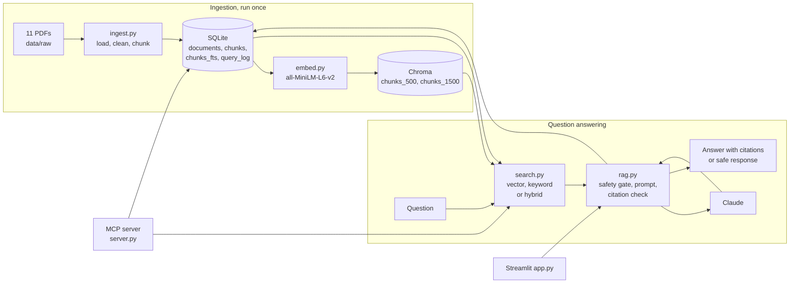
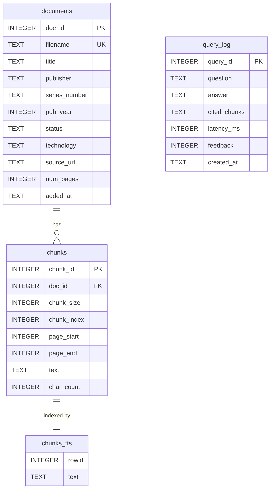

# WiSec Assistant: Final Technical Report

Advanced Database Systems, Final Project (Option 2: AI-Powered Knowledge Assistant)

Team: Satyamani Abhiram Kasireddi, Saloni Rajendra Naikwadi, Sarra Ali Ahmed Rashd

## 1. Summary

WiSec Assistant answers questions about wireless security using 11 official NIST and NSA publications. It stores document metadata and text chunks in SQLite, stores embeddings in Chroma, retrieves passages by vector, keyword or hybrid search, and asks a language model to answer using only those passages. Every answer cites the passages it used, and the system returns a safe response when the documents do not contain the answer. The same search is available to other AI clients through an MCP server with four tools.

The system was evaluated on 15 test questions. In the default configuration it answered 9 correctly, 5 partially and 1 incorrectly, and the incorrect one was a refusal, not a wrong answer. It gave the safe response to both unanswerable questions in every configuration tested, and no answer was produced without citations. Section 11 summarizes the evaluation and [evaluation.md](evaluation.md) gives the full results.

## 2. Problem and objectives

Wireless security guidance is spread over long publications: the 11 documents here total 382 pages. A person who wants to know whether public Wi-Fi is safe for banking, or how 5G hides a subscriber's identity, has to know which document to open and where to look. A general chatbot can answer from memory, but it cannot show where the answer came from, and it may describe guidance that the publications do not contain.

The project had four objectives:

1. Answer questions from the documents, including questions worded differently from the source text.
2. Show a citation (document and page) for every claim, so the reader can check it.
3. Refuse safely when the documents do not contain the answer, instead of answering from the model's memory.
4. Expose the search through MCP so other AI clients can use the collection.

## 3. Document collection

The collection has 11 public documents on one topic, wireless security, from two publishers.

| # | Series | Title | Publisher | Year | Status | Technology | Pages |
| --- | --- | --- | --- | --- | --- | --- | --- |
| 1 | SP 800-153 | Guidelines for Securing Wireless Local Area Networks (WLANs) | NIST | 2012 | Final | Wi-Fi | 24 |
| 2 | SP 800-97 | Establishing Wireless Robust Security Networks: A Guide to IEEE 802.11i | NIST | 2007 | Withdrawn | Wi-Fi | 163 |
| 3 | SP 800-121 Rev. 2 | Guide to Bluetooth Security | NIST | 2022 | Final | Bluetooth | 68 |
| 4 | SP 800-187 | Guide to LTE Security | NIST | 2017 | Final | LTE | 49 |
| 5 | CSWP 36 | Applying 5G Cybersecurity and Privacy Capabilities: Introduction to the White Paper Series | NIST | 2026 | Final | 5G | 5 |
| 6 | CSWP 36A | Protecting Subscriber Identifiers with Subscription Concealed Identifier (SUCI) | NIST | 2026 | Final | 5G | 11 |
| 7 | CSWP 36B | Using Hardware-Enabled Security to Ensure 5G System Platform Integrity | NIST | 2026 | Final | 5G | 16 |
| 8 | CSWP 36C | Reallocation of Temporary Identities | NIST | 2026 | Final | 5G | 13 |
| 9 | CSWP 36D | No SUPI-Based Paging | NIST | 2026 | Final | 5G | 12 |
| 10 | CSWP 36E | 5G Network Security Design Principles | NIST | 2026 | Final | 5G | 13 |
| 11 | CSI U/OO/166417-21 | Securing Wireless Devices in Public Settings | NSA | 2021 | Final | Wi-Fi, Bluetooth, NFC | 8 |

The years, statuses and source URLs are the values recorded in `src/init_db.py`. The documents differ in audience and style, which makes retrieval harder and the evaluation more informative: SP 800-97 is a 163-page technical guide for network engineers, while the NSA sheet is 8 pages of advice for the general public. SP 800-97 is included on purpose although NIST has withdrawn it. It is the only source for the details of IEEE 802.11i, and it lets the system demonstrate that it flags outdated sources.

## 4. System architecture

| Component | Technology | Role |
| --- | --- | --- |
| Relational database | SQLite | Document metadata, chunk text and page ranges, keyword index, query log |
| Vector database | Chroma (persistent, HNSW index, cosine distance) | One embedding per chunk |
| Embedding model | all-MiniLM-L6-v2, 384 dimensions, run locally through ONNX | Turns chunks and questions into vectors |
| Keyword search | SQLite FTS5, BM25 ranking, Porter stemming | Baseline to compare with vector search |
| Hybrid search | Reciprocal rank fusion of the two rankings | Optional extension |
| Language model | Claude (`claude-opus-5-5`) | Writes the answer from the retrieved passages |
| MCP server | Python MCP SDK (FastMCP), stdio transport | Four tools for external AI clients |
| Interface | Streamlit, plus a command line tool | Question answering with citations |

The design keeps one source of truth for text. Chunk text lives in the SQLite `chunks` table; Chroma holds the vector and uses the SQLite `chunk_id` as its ID. A vector search returns chunk IDs, and a SQL join adds the title, publisher, status and pages. Changing a document's metadata, for example marking it withdrawn, therefore never requires re-embedding.

## 5. Relational metadata schema

The full definition is in `db/schema.sql`. The main design decisions are:

- **`documents`** has one row per publication. `status` is restricted by a CHECK constraint to `final`, `draft` or `withdrawn`, and `pub_year` to a plausible range. `filename` is UNIQUE, so registering the documents twice does not duplicate them.
- **`chunks`** has one row per text chunk, with a foreign key to its document (ON DELETE CASCADE). The `chunk_size` column lets two chunking strategies live in the same table, and UNIQUE (`doc_id`, `chunk_size`, `chunk_index`) prevents duplicates. `page_start` and `page_end` make page-level citations possible. An index on (`doc_id`, `chunk_size`) serves `get_document`.
- **`chunks_fts`** is an FTS5 virtual table in external-content mode: it indexes `chunks.text` without storing a second copy. Three triggers (insert, delete, update) keep it in sync with `chunks`.
- **`query_log`** records each question, the answer, the cited chunk IDs, the latency and an optional rating of -1, 0 or 1.

## 6. Document-processing pipeline

`src/ingest.py` performs loading, cleaning and chunking.

| Step | What happens |
| --- | --- |
| Loading | `pypdf` extracts the text of each page. The page count is saved in `documents.num_pages`. |
| Header and footer removal | A line that appears on at least half of a document's pages is a running header or footer and is removed. Lines are compared with their digits masked, so a footer that contains the page number, such as `JUL 2021 Ver 1.0 3`, is recognized too. |
| Page number removal | Lines that contain only a page label (`12`, `iv`, `2-3`, `A-1`) are removed. |
| Text repair | Words split by a hyphen at a line break are rejoined, lines are joined into running text, table-of-contents dot leaders are removed and whitespace is collapsed. |
| Chunking | The cleaned text is split into chunks of at most 500 or 1,500 characters. A chunk ends at a sentence boundary when one exists in its second half. Each chunk repeats the last 15% of the previous one, so a sentence cut at a boundary is whole in one of the two. Fragments under 50 characters are dropped. |
| Page tracking | The character offset where each page starts is recorded, so every chunk knows the first and last page it covers. |

The result is 2,283 chunks at 500 characters (425 on average) and 689 chunks at 1,500 characters (1,394 on average).

| Document | Pages | Chunks at 500 | Chunks at 1,500 |
| --- | --- | --- | --- |
| SP 800-153 | 24 | 148 | 46 |
| SP 800-97 | 163 | 1,070 | 321 |
| SP 800-121 Rev. 2 | 68 | 368 | 113 |
| SP 800-187 | 49 | 304 | 90 |
| CSWP 36 | 5 | 33 | 9 |
| CSWP 36A | 11 | 61 | 18 |
| CSWP 36B | 16 | 83 | 25 |
| CSWP 36C | 13 | 65 | 20 |
| CSWP 36D | 12 | 52 | 16 |
| CSWP 36E | 13 | 58 | 18 |
| CSI U/OO/166417-21 | 8 | 41 | 13 |
| **Total** | **382** | **2,283** | **689** |

`ingest.py` rebuilds all chunks and restarts the chunk IDs at 1, so running it twice gives the same database.

## 7. Embeddings and vector search

`src/embed.py` reads the chunks from SQLite in batches of 128, embeds them and writes them to Chroma. There is one collection per chunk size (`chunks_500` with 2,283 vectors and `chunks_1500` with 689), each configured for cosine distance. Each vector carries its document ID, series number, status and pages as Chroma metadata. Embedding all 2,972 chunks takes about 4 minutes on a laptop CPU.

The embedding model is all-MiniLM-L6-v2. It was chosen because it runs locally with no API key or cost, is small enough to embed the collection in minutes, and is a common baseline for semantic search. Its limit is an input of 256 tokens, roughly 1,000 characters, so the last third of a 1,500-character chunk does not influence its vector.

`search.search()` embeds the question with the same model, asks Chroma for the k nearest vectors, and joins the returned chunk IDs with SQLite to add metadata. The score shown is cosine similarity (1 minus the distance), where 1 means the same meaning and 0 means unrelated.

`search.keyword_search()` is the comparison method. It lowercases the question, removes stopwords, joins the remaining words with OR, and ranks matches with BM25. Porter stemming lets "pairing" match "paired", but it cannot match a synonym.

`search.hybrid_search()` is an optional extension added after the first evaluation showed that each method finds passages the other misses. It takes the top 20 chunks from each method and merges them with reciprocal rank fusion: a chunk scores 1 / (60 + rank) in each list it appears in, and the sums are sorted. Only ranks are used, because cosine similarity and BM25 scores are on different scales.

## 8. Answer generation, citations and safe responses

`src/rag.py` produces an answer in five steps.

1. **Retrieve** the top k passages (default: vector search, 500-character chunks, k = 5).
2. **Safety gate.** If nothing is retrieved, or the best cosine similarity is below 0.25 (vector and hybrid modes), the system returns the safe response without calling the model. Off-topic questions such as "How do I bake sourdough bread?" score at most 0.17 against this collection, while every answerable test question scores at least 0.33.
3. **Generate.** The passages are numbered and wrapped in tags, each labeled with its source, year and whether it is withdrawn. The system prompt tells the model that the passages are its only evidence, that every claim needs a citation such as `[2]`, and that it must reply `NOT_FOUND` when the passages do not contain the answer. It also tells the model to say which part of a question is not covered, to point out ambiguity, and to ignore instructions that appear inside a passage.
4. **Check citations.** The citation numbers are parsed from the answer. Numbers that do not match a retrieved passage are reported as invalid. An answer with no valid citation is labeled `unsupported` and shown with a hallucination warning. If a cited passage comes from a withdrawn publication, a warning is added.
5. **Log** the question, answer, cited chunk IDs and latency in `query_log`.

The safe response is produced in two different ways because unanswerable questions come in two kinds. An off-topic question is caught by the similarity threshold in step 2. An on-topic question that the documents do not cover, such as one about WPA3, retrieves passages with high similarity (0.67) because the collection discusses WPA2 at length. The threshold cannot catch it, so the model must recognize that the passages do not answer the question and reply `NOT_FOUND`.

Each answer has one of three statuses.

| Status | Meaning | What the user sees |
| --- | --- | --- |
| `answered` | The answer cites at least one retrieved passage | The answer, the cited sources with page numbers, and all retrieved passages on request |
| `insufficient` | The gate or the model found no answer in the documents | The safe response, with the reason |
| `unsupported` | The model answered but cited nothing | The answer with a warning that it may be a hallucination |

The language model is called through the Anthropic API when an API key is set, or through the local `claude` command line tool otherwise. Both use the same system prompt and model. The results in this report were produced with `claude-opus-5-5` through the command line tool.

## 9. MCP server

`src/server.py` exposes the collection to any MCP client over stdio.

| Tool | Purpose |
| --- | --- |
| `search_documents(query, k, mode, chunk_size)` | Returns the most relevant passages with citation, status, score and text |
| `get_document(document, page_start, page_end, max_chars)` | Returns a document's metadata and its text, or the text of a page range |
| `list_documents()` | Lists the 11 documents with their metadata and sizes |
| `provide_feedback(rating, question, answer, cited_chunks, query_id)` | Stores a rating in `query_log` |

The server's instructions tell the client to search first, read a section with `get_document` when it needs more context, cite the series number and pages, and warn the user about withdrawn sources. Invalid input returns an error message that says what is allowed; for example, an unknown document name returns the list of available series numbers.

`tests/test_mcp.py` starts the server as a subprocess, connects with an MCP client, and sends 11 sample requests: 7 valid ones and 4 that must fail. All 11 behave as expected. Full parameter tables, sample requests and responses are in [mcp-tools.md](mcp-tools.md).

## 10. Question-answering interface

`app.py` is a Streamlit application. The user types a question or picks an example, and chooses the search method, chunk size and k in the sidebar. The answer appears with its warnings, the cited sources (each expandable to show the exact passage), the status and timing, and all retrieved passages marked as cited or not cited. Three buttons record a rating in `query_log`. A second tab lists the document collection with links to the original publications.

`python src/rag.py "question"` gives the same answer on the command line.

## 11. Testing and evaluation

The system was tested at two levels.

**MCP tools.** `tests/test_mcp.py` sends 11 sample requests through a real MCP client. All behave as expected, including the 4 error cases (Section 9).

**Retrieval and answers.** `eval/run_eval.py` runs 15 test questions: 6 direct, 3 multi-document, 3 paraphrased, 2 unanswerable and 1 ambiguous. Retrieval is scored on the 13 answerable questions for every combination of search method, chunk size and k. Answers are generated and graded for all 15 questions in five configurations. The full method, per-question results and the five required demonstration questions are in [evaluation.md](evaluation.md).

Retrieval on 13 answerable questions (500-character chunks, k = 5):

| Method | Hit@5 | MRR | P@5 | Mean time |
| --- | --- | --- | --- | --- |
| Vector | 0.92 | 0.85 | 0.66 | 116 ms |
| Keyword | 0.92 | 0.74 | 0.58 | 2 ms |
| Hybrid | 1.00 | 0.91 | 0.66 | 98 ms |

Answers on all 15 questions (automatic first-pass verdicts):

| Configuration | Correct | Partial | Incorrect | Mean response time |
| --- | --- | --- | --- | --- |
| Vector, 500 characters, k = 5 (default) | 10 | 4 | 1 | 8.8 s |
| Keyword, 500 characters, k = 5 | 10 | 4 | 1 | 7.5 s |
| Hybrid, 500 characters, k = 5 | 11 | 4 | 0 | 9.0 s |
| Vector, 1,500 characters, k = 5 | 13 | 1 | 1 | 9.7 s |
| Vector, 500 characters, k = 3 | 9 | 5 | 1 | 8.0 s |

The default configuration was also graded by hand: 9 correct, 5 partial and 1 incorrect.

The main results are:

- **Vector and keyword search fail in opposite ways.** Vector search handled reworded questions ("wireless headphones" for "Bluetooth headset") that keyword search could not, but missed a question that depends on one exact phrase ("WPA2-encryption at a minimum"), which keyword search found. Hybrid search answered both.
- **Larger chunks give more complete answers**, because a fact and its context stay in one passage, but they caused one new retrieval failure, probably because the embedding model reads only the first 1,000 or so characters of a chunk.
- **Fewer passages (k = 3) lose detail** on questions that need several documents.
- **No hallucinated answers were observed.** Both unanswerable questions were refused in all five configurations (10 of 10), including a question about WPA3 that the model could have answered from memory. Of the 61 answers given, none lacked citations and none cited a passage that was not retrieved. In the default configuration, 45 of 46 citations point to a document expected for the question.
- **Errors come from retrieval.** Every partial or incorrect baseline answer traces back to a passage that was not retrieved. In those cases the model said what was missing.
- **Response time is dominated by generation**: about 8.5 seconds, against about 0.1 seconds for vector retrieval.

## 12. Limitations

- **Small test set.** Fifteen questions written by the project team show how the system behaves but do not give statistically reliable numbers. One question changes Hit@k by 8 points.
- **Automatic grading is approximate.** Retrieval relevance and the first-pass answer verdicts rely on expected documents and key terms. The default configuration's answers were also read and graded by hand; the other configurations were not.
- **The embedding model truncates long chunks.** Text beyond about 1,000 characters of a 1,500-character chunk is stored and shown to the language model but does not affect retrieval.
- **One document dominates.** The withdrawn SP 800-97 supplies 47% of all chunks, so it wins many Wi-Fi searches over newer guidance. The system warns when it is cited but does not rank it lower.
- **Noise in the index.** Tables of contents, reference lists and glossaries are chunked like normal text and sometimes rank highly. Tables and figures lose their layout when converted to text.
- **Page numbers are PDF positions.** A citation to "p. 12" means the twelfth page of the PDF, which can differ from the number printed on the page.
- **Hyphen repair is imperfect.** Rejoining words split at line breaks also removes the hyphen from a compound that happened to break there.
- **Single-turn only.** Each question is answered on its own; a follow-up such as "and for Bluetooth?" is not understood.
- **Citation checking is structural.** The system verifies that a cited number refers to a retrieved passage. It does not verify that the passage actually supports the sentence, so a wrong attribution can pass.

## 13. Ethical considerations

- **Security advice has consequences.** A wrong answer could lead someone to trust an unsafe network or configuration. The system therefore answers only from official publications, shows the source of every claim, and refuses when it lacks evidence. It is a study and lookup aid, not a replacement for the publications or for a security professional.
- **Outdated guidance.** Security guidance ages. SP 800-97 is withdrawn, SP 800-153 dates from 2012, and the collection contains nothing on WPA3. The system flags withdrawn sources and shows the year of every source, but a reader can still take old advice as current.
- **Hallucination.** The model knows a lot about wireless security from training, and an on-topic question the documents do not cover invites it to answer from memory. The prompt forbids this and the citation check labels uncited answers, but neither is a guarantee.
- **Dual use.** The documents describe attacks such as rogue base stations and bluesnarfing in order to explain defenses. All of this material is already public and written for defenders.
- **Sources and copyright.** NIST and NSA publications are works of the U.S. government and are publicly available. The system quotes passages with attribution and links to the originals.
- **Privacy.** Questions and answers are stored in a local SQLite file. Questions are sent to the language model provider to generate answers, so users should not include confidential details about their own networks.

## 14. Future improvements

- Making hybrid search the default after testing it on a larger question set.
- A reranking step, and a ranking penalty or filter for withdrawn documents.
- Detection and removal of tables of contents and reference lists during ingestion.
- A stronger embedding model with a longer input window, compared against the current one.
- A verification step that checks each cited passage supports its sentence.
- Follow-up questions with conversation history.
- A larger test set with relevance judgments from a second reviewer.

## 15. Conclusion

The project delivers a complete retrieval-augmented system: a relational metadata store, a document-processing pipeline, a vector index, three search methods, cited answers with safe responses, a four-tool MCP server, a web interface and a repeatable evaluation.

The evaluation shows the parts working together as intended: semantic search finds passages that share no keywords with the question, the relational metadata turns each retrieved chunk into a checkable citation and a withdrawn-source warning, and the language model stays within the retrieved evidence. The main weakness is retrieval coverage: when the decisive passage is not in the top k, the answer is incomplete or refused. Hybrid search and larger chunks each reduced that problem on the test set and are the most promising directions for further work.

## References

1. NIST SP 800-153, *Guidelines for Securing Wireless Local Area Networks (WLANs)*, 2012.
2. NIST SP 800-97, *Establishing Wireless Robust Security Networks: A Guide to IEEE 802.11i*, 2007 (withdrawn).
3. NIST SP 800-121 Rev. 2, *Guide to Bluetooth Security*, 2022. https://doi.org/10.6028/NIST.SP.800-121r2-upd1
4. NIST SP 800-187, *Guide to LTE Security*, 2017.
5. NIST CSWP 36 and 36A to 36E, *Applying 5G Cybersecurity and Privacy Capabilities* white paper series.
6. NSA, *Securing Wireless Devices in Public Settings*, Cybersecurity Information Sheet U/OO/166417-21, 2021.
7. Chroma vector database. https://www.trychroma.com
8. N. Reimers and I. Gurevych, "Sentence-BERT: Sentence Embeddings using Siamese BERT-Networks," EMNLP 2019 (all-MiniLM-L6-v2 is a Sentence-Transformers model).
9. SQLite FTS5 extension. https://www.sqlite.org/fts5.html
10. Model Context Protocol specification. https://modelcontextprotocol.io
11. Anthropic, Claude API documentation. https://platform.claude.com/docs
