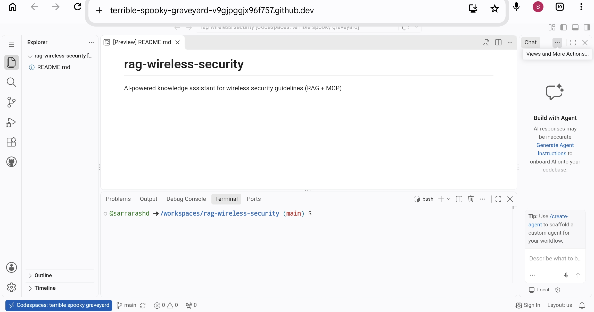
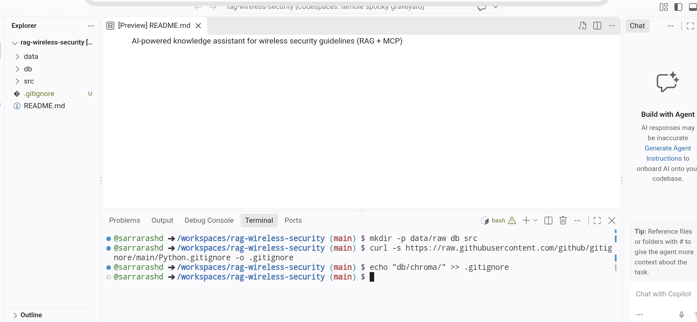
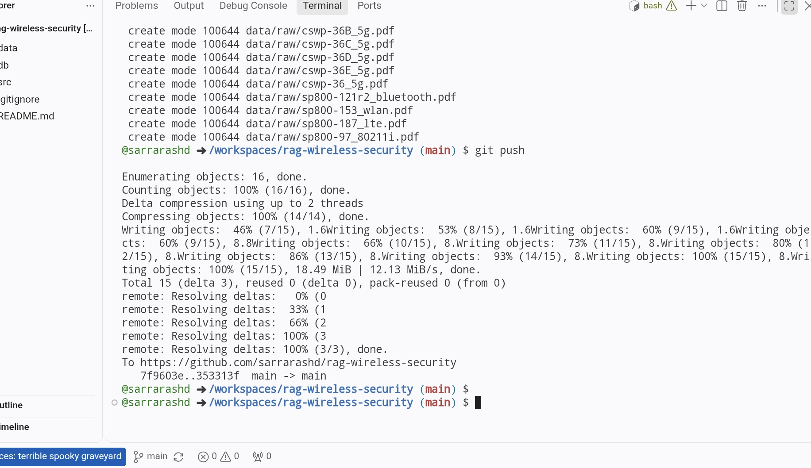
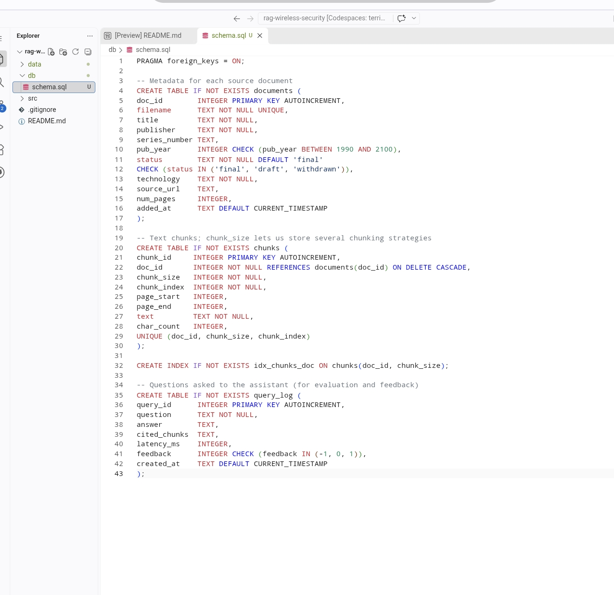
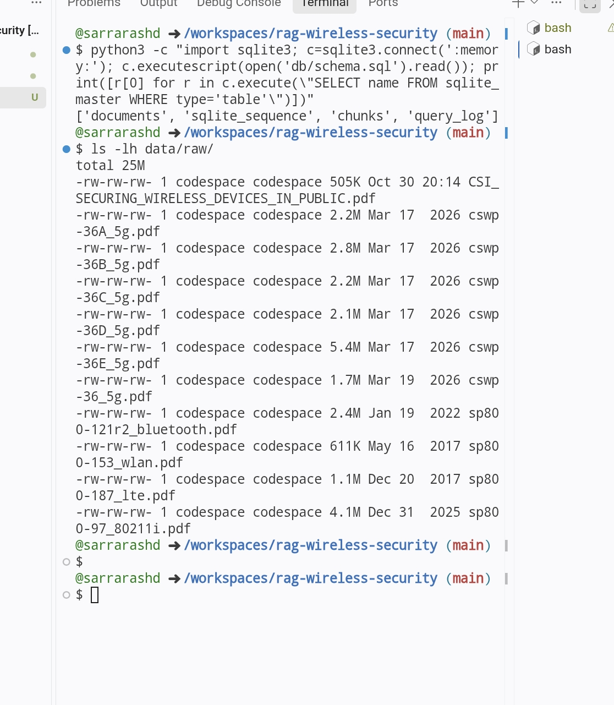
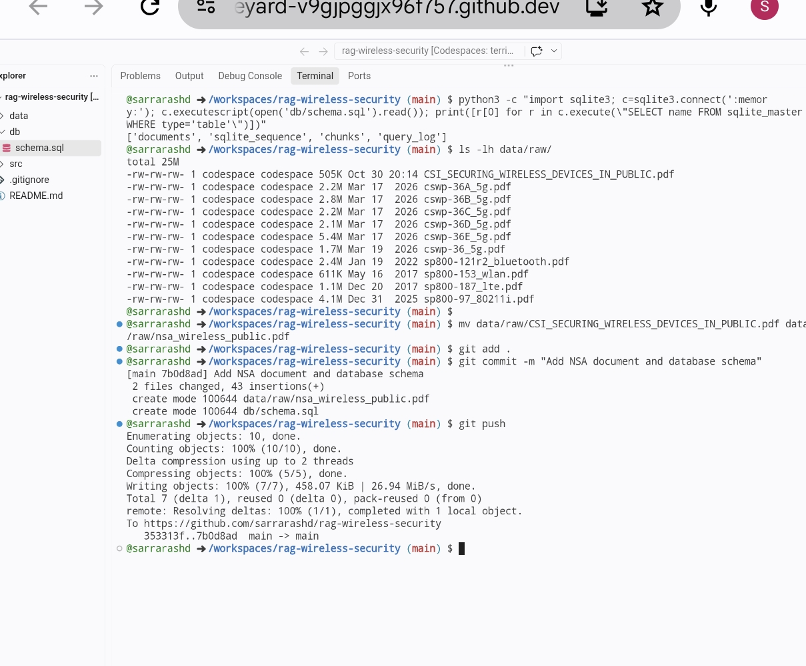
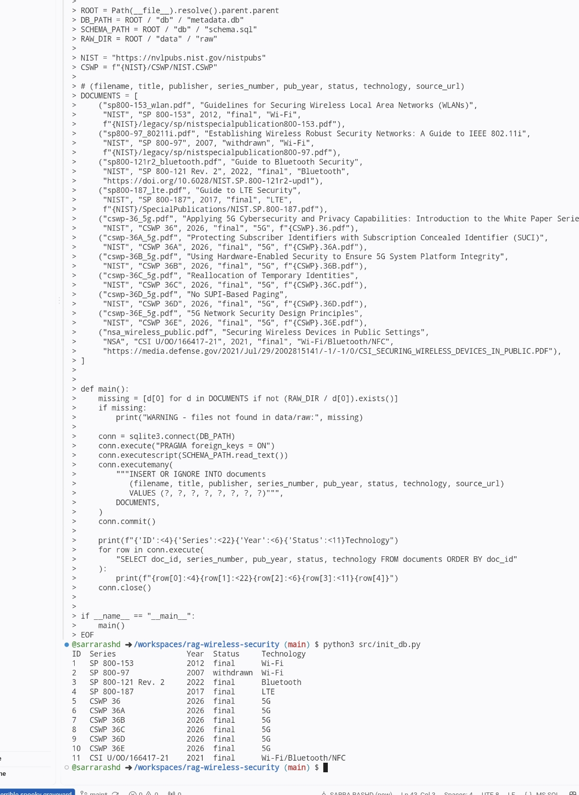
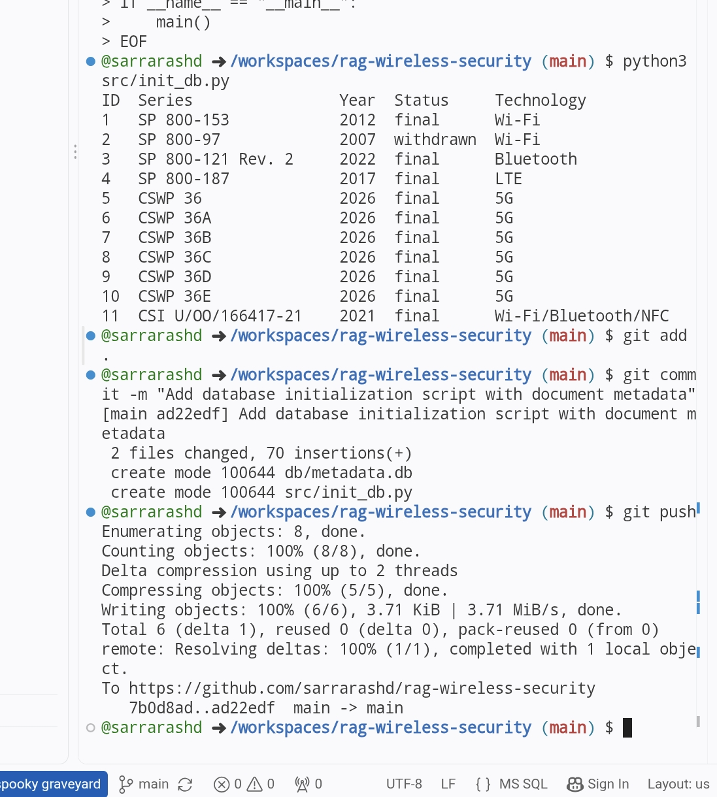

# Week 1 Progress: Document Collection and Metadata Database

Project: WiSec Assistant, an AI-powered knowledge assistant for wireless security guidelines
Course: Advanced Database Systems, Final Project (Option 2)
Period: October 16 to 30, 2026

Week 1 delivered the development environment, 11 source documents and a working SQLite metadata database, all committed to GitHub.

## 1. Development Environment

The project runs in GitHub Codespaces, a cloud Linux environment opened from the browser. This keeps the work independent of the local machine and saves every change to the repository.

*Figure 1. The Codespace running VS Code with a bash terminal in the `rag-wireless-security` repository.*

## 2. Project Structure

Three folders were created: `data/raw` for source PDFs, `db` for the database and `src` for code. A Python `.gitignore` was added, excluding the Chroma vector store, which is rebuilt from code.

*Figure 2. Folder structure and `.gitignore` created from the terminal.*

## 3. Document Collection

Ten documents were downloaded directly from NIST with `wget` and committed to GitHub (about 18 MB).

*Figure 3. Git commit and push of the first 10 source documents.*

The NSA document could not be downloaded from the Codespace because the server rejected the request. It was downloaded in the browser and uploaded manually. Figure 5 shows the final set of 11 documents.

## 4. Relational Metadata Schema

The schema defines three tables: `documents`, `chunks` and `query_log`. It uses primary and foreign keys, UNIQUE, CHECK and NOT NULL constraints, and an index on `chunks(doc_id, chunk_size)`.

*Figure 4. The complete `db/schema.sql` file (43 lines).*

The schema was tested by loading it into an in-memory SQLite database. All tables were created without errors. The listing below it confirms all 11 documents are present.

*Figure 5. Schema test output (`documents`, `sqlite_sequence`, `chunks`, `query_log`) and the 11 source PDFs.*

*Figure 6. The NSA document renamed and committed together with the schema.*

## 5. Database Initialization

`src/init_db.py` creates `db/metadata.db` from the schema and registers all 11 documents. SP 800-97 is the only document marked `withdrawn`, which will let the assistant flag outdated sources.

*Figure 7. Output of `init_db.py`: 11 documents with series number, year, status and technology.*

*Figure 8. `init_db.py` and `metadata.db` committed and pushed to GitHub.*

## Issues Encountered

| Issue | Cause | Solution |
| --- | --- | --- |
| The first editor had no terminal | github.dev (web editor) was opened instead of a Codespace | Created a Codespace from the repository's Code menu |
| NSA PDF downloaded as 0 bytes | The server rejected command-line downloads | Downloaded in the browser and uploaded to the Codespace |
| Pasted SQL had growing indentation | Editor auto-indent on paste | Removed leading spaces with `sed`; Python files are created from the terminal |
| Codespace disconnected | Automatic stop after inactivity | Reopened the existing Codespace from github.com/codespaces |
